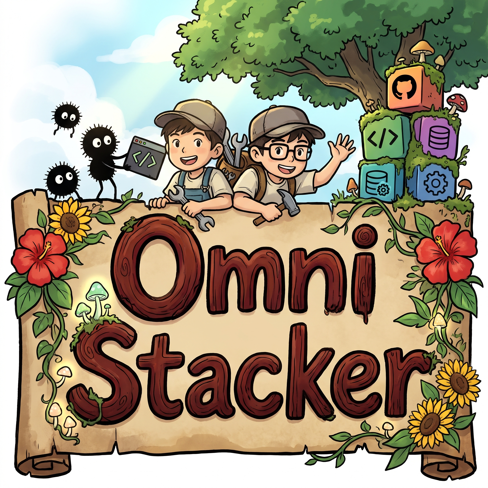

<div align="center">



# OmniStacker

**一支把“全栈”写进日常、而不是写进简历的工程小队。**

`前端到内核，设计稿到 K8s，没有交接棒，只有接力赛。`

[](https://www.typescriptlang.org/)
[](https://react.dev/)
[](https://nextjs.org/)
[](https://vuejs.org/)
[](https://dotnet.microsoft.com/)
[](https://nodejs.org/)
[](https://go.dev/)
[](https://www.rust-lang.org/)
[](https://www.python.org/)
[](https://www.postgresql.org/)
[](https://redis.io/)
[](https://www.docker.com/)
[](https://kubernetes.io/)
[](https://aws.amazon.com/)

</div>

---

## 🧭 我们是谁

我们是 **OmniStacker**。

两个人，一个共识：**技术栈不是身份标签，只是解决问题的抽屉。** 需求从用户点下按钮的那一刻开始，一路穿过组件树、API 网关、事务、缓存、消息队列、容器、CDN，直到那块被压到极限的网卡——这条链路，**我们两个都能从第一像素讲到最后一字节**。

> **人数：两个。** 覆盖面：Android 扫码 → UWP 看图 → 微信小程序 → Go 监控面板 → Vue3 管理后台 → C++ 精简版编辑器 → Incus 上的 VPS 交付平台。清单长到这个程度，是因为每个项目都没外包给“下一个环节”。

- 🧩 **不分层站队**：每个人都能独立交付一条完整的 vertical slice（UI → API → 存储 → 部署 → 监控）。
- ⚡ **交接成本趋近于零**：不用等“前端排期”“后端排期”，一个 PR 就能把一整个功能打通。
- 🧠 **懂取舍的深度**：全栈不等于全都浅。每个人有一个真正的深水区，也有一圈足够宽的浅滩。
- 🚢 **上线是习惯**：主干开发、小步快跑、默认自动化。发版不是仪式，是日常。
- 🪶 **轻量是信仰**：能不引依赖就不引，能砍的包就砍，能零依赖跑起来的服务绝不拖一个运行时装上去。

> 简历上写“熟悉前后端”的人很多；能把 `git bisect` 从 UI 画到内核的人不多。我们在后者里。

---

## 🧱 能力矩阵

不是“会”，是“能交付”。

| 领域 | 我们的日常武器 | 真实能做的事 |
| :--- | :--- | :--- |
| **前端 / UI** | TypeScript、React、Next.js、Vue、Tailwind、Vite、Web Components | 像素级还原 → 设计系统化 → 组件库沉淀，性能预算卡在 CI 里 |
| **移动 / 跨端** | React Native、Expo、Tauri、PWA | 一套领域模型，多端落地，热更新链路打通 |
| **后端 / API** | Node.js (Nest/Fastify)、Go、Rust (axum)、Python (FastAPI) | REST / GraphQL / gRPC 设计，幂等、限流、灰度、优雅降级 |
| **数据 / 存储** | PostgreSQL、MySQL、Redis、ClickHouse、SQLite、Prisma / Drizzle | 索引与执行计划调优、分库分表、CDC 同步、缓存一致性 |
| **基建 / 云原生** | Docker、Kubernetes、Terraform、Helm、GitHub Actions、Cloudflare | IaC 一把梭、蓝绿/金丝雀发布、成本与容量双控 |
| **可观测性** | OpenTelemetry、Prometheus、Grafana、Loki、Sentry | 从告警反推到那行代码，平均定位时间按分钟算 |
| **AI / 数据** | LLM 应用、RAG、向量检索、pgvector、流式推理 | 把模型能力包成稳定产品，而不是 demo |
| **工程效能** | Monorepo、Changesets、ESLint/Biome、Vitest/Playwright | 工具链自己造，规范写进 hook 里，不靠口头约定 |

**结论：** 从设计稿第一像素，到生产环境最后一条 trace，中间没有黑盒。

---

## 👥 组员

| 成员 | 定位 | 主攻 | 副攻 | 招牌能力 |
| :--- | :--- | :--- | :--- | :--- |
| [@letsopen](https://github.com/letsopen) | 🧰 全栈 · 多语言游击派 | Go 服务端 · C# / Android 原生客户端 | C++ 精简裁剪、微信小程序、Python 工具链、Incus 虚拟化交付 | 从客户端到服务端一个人打通，且**零依赖**也要跑起来 |
| [@jxhutao](https://github.com/jxhutao) | 🎨 全栈 · 前端工程派 | Vue3 / TypeScript / Vite · Monorepo 工程化 | Shadcn UI 组件体系、中后台架构、Node 侧 BFF | 把管理后台做成**三年后还敢改**的产品 |

<details>
<summary><b>按人展开：一个人 = 一整条技术栈</b></summary>

<br/>

### 🧰 [@letsopen](https://github.com/letsopen)

一份仓库列表就能看出跨度：**Go、C#、C++、Java、JavaScript、Python** 全都在射程内，而且每个都不是“教程复刻”。

- **Go · 服务端** — [`ProMonitor`](https://github.com/letsopen/ProMonitor)：超轻量服务器监控面板；[`ollama-openai-bridge`](https://github.com/letsopen/ollama-openai-bridge)：零依赖 Go 代理，把 JetBrains AI Assistant（走 Ollama 协议）接到任意 OpenAI 兼容 API，顺手解决了 stream EOF、DTO 严格序列化、模型列表动态同步这些坑。
- **Java · Android** — [`ProScan`](https://github.com/letsopen/ProScan)：安卓条码/二维码扫描工具，同时兼容华为 HMS Scan、Google ML Kit 与经典 ZXing 三套引擎——多套 SDK 抽象成一个接口。
- **C# · 桌面** — [`ProView`](https://github.com/letsopen/ProView)：Windows UWP 极简图片查看器；**C++ · 底层** — 对 Notepad++、SciTE、FileZilla 做过精简版，能不带的模块全砍掉。
- **JavaScript · 小程序 / Python · 工具链** — [`ProSender`](https://github.com/letsopen/ProSender) 小程序文件互传、[`ncm-auto`](https://github.com/letsopen/ncm-auto) 自动化脚本。
- **Infra · 虚拟化** — [`incudal`](https://github.com/letsopen/incudal)：基于 Incus 的 LXC / KVM NAT VPS 销售、交付与管理面板，从底层资源编排一路做到用户前台。

> “能少一个依赖就少一个。C++ 我能精简，Go 我能单文件跑起来。”

### 🎨 [@jxhutao](https://github.com/jxhutao)

- **Vue3 全链路** — Vue 3 + TypeScript + Vite 的组合拳，响应式与组合式 API 用到通透。
- **中后台工程化** — 长期在 Vue3 + Shadcn UI + Monorepo 的管理后台体系里打磨：权限、路由、表单引擎、主题、构建拆分。
- **类型与规范** — 把 TypeScript 类型当成设计工具，而不是报错消音器。

> “后台系统真正的难点不是写页面，是让它三年后还能改。”

</details>

---

## 🧠 我们的全栈哲学

1. **Vertical Slice over Handoff** — 按业务切片分活，不按技术层切人。一个功能的 DB、API、UI、部署，一个人负责到底。
2. **Depth before Breadth** — 每个人先有一口深井，再向外扩。全栈是结果，不是借口。
3. **Boring by Default** — 默认选成熟方案，把创新预算留给真正的差异点。
4. **Paved Road** — 新项目开箱即用：脚手架、CI、预览环境、监控、告警，全自动。
5. **Ship, then Sharpen** — 先上生产拿反馈，再回头做抽象。抽象是为第二次服务的。
6. **Leave It Better** — 每个 PR 都让仓库比昨天干净一点。

---

## 🛠 工程规范（写在 hook 里，不写在幻灯片里）

```text
分支模型   trunk-based + 短生命周期分支（< 2 天）
提交规范   Conventional Commits + Changesets
质量门禁   Biome / ESLint · tsc --noEmit · Vitest · Playwright · 覆盖率不倒退
评审文化   24h 内有人看；讨论聚焦接口与权衡，不纠结空格
发布策略   Preview 环境随 PR 生成 · 蓝绿 / 金丝雀 · 一键回滚
```

---

## 🚀 我们在做的事

| 项目 | 一句话 | 技术栈 |
| :--- | :--- | :--- |
| [**ProMonitor**](https://github.com/letsopen/ProMonitor) | 超轻量服务器监控面板，单二进制丢上去就能跑 | Go |
| [**ollama-openai-bridge**](https://github.com/letsopen/ollama-openai-bridge) | 零依赖 Go 代理，把 JetBrains AI Assistant 接到任意 OpenAI 兼容 API，连 stream EOF 都替你摆平 | Go · Ollama 协议 |
| [**ProScan**](https://github.com/letsopen/ProScan) | Android 扫码工具，华为 HMS / Google ML Kit / ZXing 三引擎可切换 | Java · Android |
| [**incudal**](https://github.com/letsopen/incudal) | 基于 Incus 的 LXC / KVM NAT VPS 销售、交付与管理面板 | Incus · 虚拟化 |
| [**ProView**](https://github.com/letsopen/ProView) | Windows UWP 极简风格图片查看器 | C# · UWP |

---

## 🤝 加入我们

我们更在意这些：

- 你**跑通过**一个完整系统，而不只是用过它的某层；
- 你愿意为一个接口设计争论半小时，也愿意为一次误判道歉；
- 你相信**工具和规范**比“下次注意”更可靠。

如果你也认为“这不是我的模块”是最无趣的一句话 —— 来聊聊。

📮 联系：[开个 Issue](https://github.com/OmniStacker/.github/issues) · 或者直接给任意一位组员发 PR。

---

<div align="center">

**OmniStacker** — *We don't hand off. We ship.*

<sub>从像素到内核，从本地到生产。</sub>

</div>
